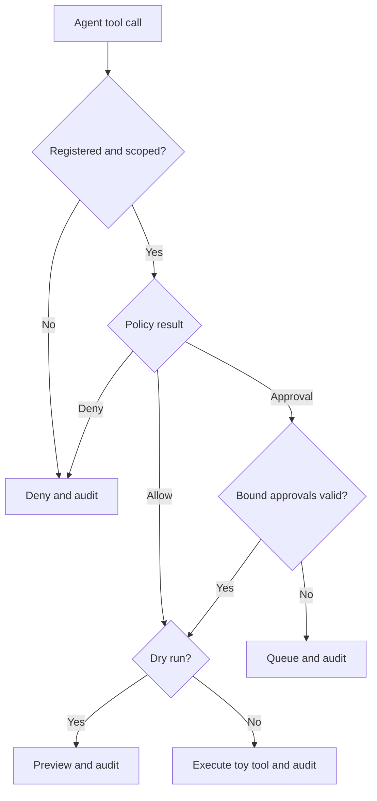

# ScopeLock

[](https://github.com/MadanMohan0537/scopelock/actions/workflows/ci.yml)

ScopeLock is a local, dependency-free authorization gateway between AI agents and the tools they call. It enforces least privilege, readable rules, dry runs, approval thresholds, approval-bound execution, and a tamper-evident audit trail.

> **Project Lab traceability:** catalog Project 06, originally “Tool Permission and Policy Engine.” ScopeLock is the product name; this metadata prevents the renamed idea from being built twice.

## Why it exists

Giving an agent a broad API credential turns one hallucinated argument or injected instruction into a real side effect. ScopeLock treats the agent as an untrusted caller. Every request is checked against a registered tool version, the agent's scopes, contextual rules, and—where required—approval evidence.

## Implemented workflow

- Deny unknown tools by default.
- Give each agent explicit read/write scopes.
- Enforce transfer amount limits, recipient allowlists, allowed hours, and distinct dual approval.
- Auto-execute low-risk reads and low-value approved writes.
- Preview permitted actions without mutating state.
- Simulate a bank ledger, CRM, and email sender with reproducible local data.
- Store every decision in SQLite with a verifiable SHA-256 hash chain.
- **P1 approval binding:** hash canonical arguments, tool name, and tool version; enforce expiry and reject modified requests at execution time.
- **P2 policy migration rehearsal:** replay a redacted synthetic call corpus under versioned old and new policies, explain every transition, and block promotion when observed changes differ from the predeclared change set.

Authentication, Slack approvals, OPA/Cedar integration, production tool adapters, sequence-aware rules, network isolation, and a hosted review UI are planned—not implemented.

## Quick start

```bash
python -m venv .venv
source .venv/bin/activate
python -m pip install -e .
scopelock --db scopelock.db --json report.json
```

No API key, model, network request, paid service, or real account is used.

Run tests:

```bash
python -m unittest discover -s tests -v
```

## Decision flow



## P1 approval-binding experiment

The frozen test suite grants an approval for a $250 transfer to `vendor-42` using tool version `2.1`. The unchanged request executes. Changing the amount, recipient, tool version, or execution time beyond expiry invalidates the approval. High-value transfers also require two distinct approver identities.

The experiment is intentionally deterministic. Passing it demonstrates correct binding mechanics—not security certification or production readiness.

## P2 policy-migration experiment

The frozen migration lowers the automatic-transfer threshold from $100 to $50
and removes one allowed recipient. Before evaluation, the owner declares the
two calls expected to change. ScopeLock then evaluates the same redacted calls
under both versioned policies without executing tools:

| Call | Old decision | New decision | Interpretation |
|---|---|---|---|
| Operating-account read | Allow | Allow | Stable control |
| $75 vendor transfer | Allow | Approval required | Approval workload increase |
| $20 removed-recipient transfer | Allow | Deny | Newly blocked user |
| Existing disallowed recipient | Deny | Deny | Stable control |

The matching fixture recommends promotion. Omitting either declared change or
introducing an undeclared transition changes the recommendation to block.
Reports include policy digests and source-record digests for reproducibility.

## Policy example

```python
from scopelock.gateway import build_gateway
from scopelock.models import ToolCall

gateway = build_gateway()
result = gateway.handle(ToolCall(
    call_id="call-001",
    agent_id="operator",
    tool="ledger.transfer",
    arguments={"amount": 75, "recipient": "vendor-42"},
    requested_at="2026-10-09T12:00:00+00:00",
))
assert result.outcome == "executed"
```

## Security and limitations

ScopeLock is a portfolio-scale reference implementation, not a production security boundary. The in-process caller could bypass it; approver identities are strings; the SQLite hash chain detects accidental or unsophisticated edits but is not externally anchored; canonical JSON does not capture external state; and the toy tools do not model real provider failure semantics. Migration rehearsal covers only its saved corpus, rejects obvious secret-bearing fields but does not prove full de-identification, and cannot predict novel future calls. See [the threat model](docs/THREAT_MODEL.md).

## Roadmap

The rigorously specified [backlog](docs/BACKLOG.md) compares proposed features with shipped controls. The next priority is sequence-aware rules, followed by approval-capacity modeling.

## Repository structure

```text
scopelock/       gateway, rules, approvals, migration rehearsal, audit log, demo tools
tests/           deterministic policy and attack-path tests
docs/            threat model and evidence-driven backlog
.github/         CI across Python 3.11–3.13
```

## License

MIT

